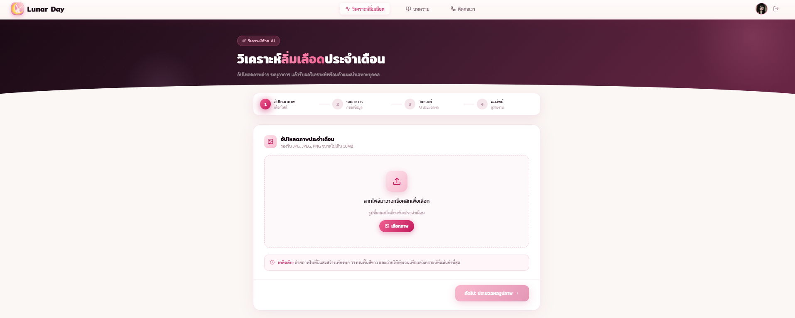

<div align="center">

# 🌙 Lunar Day

### AI-Powered Menstrual Health Analysis

เว็บแอปพลิเคชันสำหรับประเมินความเสี่ยงเบื้องต้นจากภาพลิ่มเลือดประจำเดือน
ด้วยเทคโนโลยีปัญญาประดิษฐ์และการเรียนรู้เชิงลึก


**ดูแลสุขภาพสตรีด้วย AI เพื่อความเข้าใจสุขภาพประจำเดือนที่ดียิ่งขึ้น**

</div>

---

## 📑 สารบัญ

- [เกี่ยวกับโปรเจกต์](#เกี่ยวกับโปรเจกต์)
- [เทคโนโลยีและเครื่องมือที่ใช้](#เทคโนโลยีและเครื่องมือที่ใช้)
- [โครงสร้างโปรเจกต์](#โครงสร้างโปรเจกต์)
- [การติดตั้งแบบ Localhost](#การติดตั้งแบบ-localhost)
- [การใช้งานผ่าน Vercel และ Cloudflare](#การใช้งานผ่าน-vercel-และ-cloudflare)
- [การทดสอบระบบ](#การทดสอบระบบ)
- [ฟังก์ชันการใช้งาน](#ฟังก์ชันการใช้งาน)
- [Backend API](#backend-api)
- [การแก้ไขปัญหา](#การแก้ไขปัญหา)
- [ข้อควรระวัง](#ข้อควรระวัง)
- [Contributing](#contributing)

---


---

## เกี่ยวกับโปรเจกต์

**Lunar Day** เป็นเว็บแอปพลิเคชันที่พัฒนาขึ้นเพื่อช่วยประเมินความเสี่ยงเบื้องต้นจากลิ่มเลือดประจำเดือน โดยใช้เทคโนโลยีปัญญาประดิษฐ์ ในการวิเคราะห์ภาพร่วมกับข้อมูลอาการที่ผู้ใช้งานกรอกผ่านแบบสอบถาม ระบบจะแสดงผลการประเมินความเสี่ยง พร้อมคำแนะนำเบื้องต้น เพื่อส่งเสริมให้ผู้หญิงเข้าใจและใส่ใจสุขภาพประจำเดือนของตนเองมากยิ่งขึ้น ทั้งนี้ ข้อมูลด้านสุขภาพและแนวทางการประเมินได้รับคำปรึกษาจากแพทย์สูตินรีเวช

ระบบแบ่งผลการประเมินออกเป็น 5 ระดับ ดังนี้

| สัญลักษณ์ | ระดับความเสี่ยง |
|---|---|
| 🟢 | ปกติ |
| 🟡 | เสี่ยงปานกลาง |
| 🟠 | เสี่ยงสูง |
| 🔴 | ฉุกเฉิน |
| ⚪ | ไม่พบความเสี่ยงที่ชัดเจน |


### การพัฒนาและคัดเลือกโมเดล AI
ในการพัฒนาโมเดลสำหรับวิเคราะห์ภาพ ผู้พัฒนาได้ทดลองและเปรียบเทียบโมเดลทั้งหมด 4 สถาปัตยกรรม ได้แก่ ResNet50, EfficientNet-B0, DenseNet121 และ InceptionResNetV2 โดยทดลองใช้อัตราการเรียนรู้  จำนวน 3 รูปแบบ ได้แก่ 0.001, 0.0001 และ 0.00001 จากผลการทดลอง ได้คัดเลือก **InceptionResNetV2 ที่ใช้อัตราการเรียนรู้ 0.0001** เป็นโมเดลที่มีประสิทธิภาพเหมาะสมที่สุด และนำโมเดลดังกล่าวไปพัฒนาต่อ โดยทดลองเปรียบเทียบฟังก์ชันการสูญเสีย จำนวน 4 รูปแบบ ได้แก่

1. Weighted Cross-Entropy (WCE)
2. Dice Loss
3. WCE + Dice Loss
4. Tversky Loss

จากกระบวนการทดลองและเปรียบเทียบประสิทธิภาพของโมเดล ทั้งในด้านสถาปัตยกรรม อัตราการเรียนรู้ และฟังก์ชันการสูญเสีย ผู้พัฒนาได้คัดเลือก InceptionResNetV2 ที่ใช้อัตราการเรียนรู้ 0.0001 เป็นโมเดลสำหรับนำไปพัฒนาและใช้งานในระบบ Lunar Day โดยพิจารณาจากผลการประเมินที่ใช้ค่า Recall และ Dice Similarity Coefficient (DSC) เป็นเกณฑ์หลัก ร่วมกับ Precision, Learning Curve และ Intersection over Union (IoU)


### ✨ ฟีเจอร์หลัก
- 📝 **User Registration** — สมัครสมาชิกและสร้างบัญชีผู้ใช้งาน
- 🔬 **AI Image Analysis** — วิเคราะห์ภาพลิ่มเลือดประจำเดือนด้วยเทคโนโลยี AI และประเมินความเสี่ยง
- 📚 **Health Articles** — คลังบทความและความรู้ด้านสุขภาพผู้หญิง
- 🗂️ **Analysis History** — บันทึกและเรียกดูประวัติการวิเคราะห์
- 👤 **User Profile** — จัดการข้อมูลส่วนตัวและบัญชีผู้ใช้งาน

> **หมายเหตุ:** Lunar Day เป็นเครื่องมือสำหรับประเมินความเสี่ยงเบื้องต้น ไม่สามารถใช้แทนการวินิจฉัยจากแพทย์ได้


[กลับไปสารบัญ](#สารบัญ)


## เทคโนโลยีและเครื่องมือที่ใช้

| ส่วนประกอบ | เทคโนโลยี / เครื่องมือ | เวอร์ชัน | ดาวน์โหลด |
| :--- | :--- | :--- | :--- |
| Frontend | Next.js | 16.2.0 | [เว็บไซต์](https://nextjs.org/) |
| | React | 19.2.4 | [เว็บไซต์](https://react.dev/) |
| | TypeScript | 5.9.3 | [ดาวน์โหลด](https://www.typescriptlang.org/download/) |
| | Tailwind CSS | 4.2.2 | [เว็บไซต์](https://tailwindcss.com/) |
| Runtime | Node.js | 24.19.0 | [ดาวน์โหลด](https://nodejs.org/en/download) |
| | npm | 11.17.0 | ติดตั้งพร้อม Node.js |
| Backend | Python | 3.13.11 | [ดาวน์โหลด](https://www.python.org/downloads/) |
| | Flask | 3.1.3 | [เว็บไซต์](https://flask.palletsprojects.com/) |
| AI / Deep Learning | PyTorch | 2.13.0 | [เว็บไซต์](https://pytorch.org/get-started/locally/) |
| | segmentation-models-pytorch | 0.5.0 | [GitHub](https://github.com/qubvel-org/segmentation_models.pytorch) |
| | OpenCV | 5.0.0.93 | [เว็บไซต์](https://opencv.org/get-started/) |
| Image Annotation | Roboflow | - | [เว็บไซต์](https://roboflow.com/) |
| Database | MySQL Community Server - GPL | 26.7 | [ดาวน์โหลด](https://dev.mysql.com/downloads/mysql/) |
| Database Management Tool | MySQL Workbench | 8.0.47 | [ดาวน์โหลด](https://dev.mysql.com/downloads/workbench/) |
| Version Control | Git | 2.55.0.windows.4 | [ดาวน์โหลด](https://git-scm.com/downloads) |
| Code Editor | Visual Studio Code | - | [ดาวน์โหลด](https://code.visualstudio.com/Download) |
| Frontend Hosting | Vercel | - | [เว็บไซต์](https://vercel.com/) |
| Backend Tunnel | Cloudflare Quick Tunnel (cloudflared) | 2026.10.3 | [ดาวน์โหลด](https://developers.cloudflare.com/cloudflare-one/networks/connectors/cloudflare-tunnel/downloads/) |

หมายเหตุ:
- npm ติดตั้งมาพร้อมกับ Node.js
- Flask, PyTorch, segmentation-models-pytorch และ OpenCV ติดตั้งผ่าน pip
- Next.js, React, TypeScript และ Tailwind CSS ติดตั้งผ่าน npm
- Cloudflared จำเป็นเฉพาะกรณีใช้งาน Cloudflare Quick Tunnel
- เวอร์ชันที่ระบุเป็นเวอร์ชันจากสภาพแวดล้อมที่ใช้พัฒนาโปรเจกต์


### ไฟล์โมเดลและไฟล์ฐานข้อมูล

| ไฟล์ | รายละเอียด |
| :--- | :--- |
| `Dump_Lunar_0.1.sql` | ไฟล์ SQL Dump สำหรับนำเข้าโครงสร้างและข้อมูลของฐานข้อมูล MySQL |
| `incep_exp12.pth` | ไฟล์โมเดล AI ที่ผ่านการฝึกสอนแล้ว ให้วางไว้ในโฟลเดอร์ `backend/` |

**ลิงก์ดาวน์โหลดไฟล์**

- ดาวน์โหลดไฟล์ฐานข้อมูล: [Dump_Lunar_0.1.sql](https://drive.google.com/file/d/10cjGha7Z7lvXuD48L3SGK4VAGqQcYY_5/view?usp=drive_link)
- ดาวน์โหลดไฟล์ AI Model: [incep_exp12.pth](https://drive.google.com/file/d/1aZNYYyzp_yvnleVKbwixL3YVA3ZXlUKB/view?usp=sharing)

[กลับไปสารบัญ](#สารบัญ)

## โครงสร้างโปรเจกต์

```text
Lunar-Day/
│
├── backend/
│   ├── app.py
│   ├── extensions.py
│   ├── requirements.txt
│   ├── .env.example
│   ├── incep_exp12.pth
│   ├── config/
│   ├── routes/
│   ├── static/
│   │   └── uploads/
│   └── uploads/
│
├── frontend/
│   ├── package.json
│   ├── package-lock.json
│   ├── next.config.ts
│   ├── .env.local.example
│   ├── public/
│   └── app/
│       ├── layout.tsx
│       ├── page.tsx
│       ├── login/
│       ├── signup/
│       ├── forgot-password/
│       ├── components/
│       ├── lib/
│       └── home/
│           ├── analyze/
│           ├── articles/
│           ├── profile/
│           └── contact/
│
├── Dump_Lunar_0.1.sql
├── .gitignore
└── README.md     └── contact/
```

[กลับไปสารบัญ](#สารบัญ)

# การติดตั้งและใช้งานระบบแบบ Localhost

## 1. ดาวน์โหลดโปรเจกต์

ก่อนเริ่มติดตั้ง ตรวจสอบว่ามีโปรแกรมที่จำเป็น ได้แก่

- Git
- Python
- Node.js และ npm
- MySQL Server
- MySQL Workbench (สำหรับจัดการฐานข้อมูล)

เปิด Command Prompt (CMD) แล้วใช้คำสั่ง

```bat
git clone https://github.com/yourmenis/Lunar-Day.git
cd Lunar-Day
```

> หมายเหตุ: เปลี่ยน URL ตัวอย่างด้านบนเป็น GitHub Repository จริงของโปรเจกต์ก่อนใช้งาน

## 2. สร้างฐานข้อมูล MySQL

ดาวน์โหลดไฟล์ `Dump_Lunar_0.1.sql` จากลิงก์ดาวน์โหลดที่กำหนดไว้ในส่วนไฟล์โมเดลและไฟล์ฐานข้อมูล

เปิด MySQL Workbench และเชื่อมต่อ MySQL Server จากนั้นเลือกเมนู **Server → Data Import**

1. เลือก **Import from Self-Contained File**
2. เลือกไฟล์ `Dump_Lunar_0.1.sql`
3. ตรวจสอบว่าไม่ได้เลือกฐานข้อมูลปลายทางอื่นที่ขัดกับฐานข้อมูลในไฟล์ SQL Dump
4. กด **Start Import** เพื่อเริ่มนำเข้าฐานข้อมูล

ไฟล์ SQL Dump มีคำสั่งสร้างฐานข้อมูล `userdb` และเลือกใช้งานฐานข้อมูลดังกล่าวอยู่แล้ว จึงไม่จำเป็นต้องสร้างฐานข้อมูลด้วยตนเองก่อน Import

เมื่อนำเข้าสำเร็จ จะได้ฐานข้อมูลชื่อ `userdb` พร้อมตารางและข้อมูลที่จำเป็นสำหรับระบบ Lunar Day

**กรณีใช้ Command Prompt (CMD)** สามารถนำเข้าฐานข้อมูลด้วยคำสั่งต่อไปนี้ โดยเปลี่ยนตำแหน่งไฟล์ให้ตรงกับเครื่องที่ใช้งาน

```bat
mysql -u root -p < "C:\path\to\Dump_Lunar_0.1.sql"
```

จากนั้นกรอกรหัสผ่าน MySQL เมื่อระบบร้องขอ

> หมายเหตุ: คำสั่งนี้ใช้ผ่าน CMD ที่สามารถเรียกใช้คำสั่ง `mysql` ได้ หากไม่พบคำสั่ง ให้ตรวจสอบการติดตั้ง MySQL และ PATH หรือใช้เมนู Data Import ใน MySQL Workbench

ตารางหลักของระบบ ได้แก่

- `User` — ข้อมูลบัญชีผู้ใช้
- `Risk_Assessment` — ผลการประเมินความเสี่ยง
- `Article` — บทความสุขภาพ
- `TokenBlacklist` — Token ที่ถูกยกเลิก

## 3. ติดตั้ง Backend

เปิด CMD และตรวจสอบว่าอยู่ในโฟลเดอร์หลัก `Lunar-Day` จากนั้นใช้คำสั่ง

```bat
cd backend
python -m venv venv
venv\Scripts\activate
python -m pip install --upgrade pip
pip install -r requirements.txt
```

คำสั่งข้างต้นจะสร้าง Virtual Environment และติดตั้งไลบรารีที่จำเป็นสำหรับ Backend ตามรายการในไฟล์ `requirements.txt`

เมื่อติดตั้งสำเร็จ จะสามารถใช้งาน Python Environment สำหรับโปรเจกต์นี้ได้

หากติดตั้ง PyTorch ไม่สำเร็จ ให้ตรวจสอบคำสั่งติดตั้งที่ [เว็บไซต์ PyTorch](https://pytorch.org/get-started/locally/)

## 4. วางไฟล์ AI Model

ดาวน์โหลดไฟล์ `incep_exp12.pth` แล้ววางไว้ในโฟลเดอร์ `backend/` ระดับเดียวกับไฟล์ `app.py`

ตัวอย่างโครงสร้างไฟล์

```text
Lunar-Day/
└── backend/
    ├── app.py
    ├── incep_exp12.pth
    ├── requirements.txt
    ├── config/
    └── ...
```

## 5. ตั้งค่าไฟล์ .env

สร้างไฟล์ `.env` ภายในโฟลเดอร์ `backend/` แล้วกำหนดค่าตามตัวอย่าง

```env
JWT_SECRET_KEY=ข้อความลับที่คาดเดายาก
DB_HOST=localhost
DB_USER=root
DB_PASSWORD=รหัสผ่าน MySQL
DB_NAME=userdb
GMAIL_USER1=อีเมล Gmail สำหรับส่ง OTP
GMAIL_APP_PASSWORD=App Password ของ Gmail
SERVER_URL=http://localhost:5000
```

**รายละเอียดการตั้งค่า**

| ตัวแปร | รายละเอียด |
|---|---|
| `JWT_SECRET_KEY` | Secret Key สำหรับสร้างและตรวจสอบ JWT Token |
| `DB_HOST` | ที่อยู่ของ MySQL Server |
| `DB_USER` | ชื่อผู้ใช้งาน MySQL |
| `DB_PASSWORD` | รหัสผ่าน MySQL |
| `DB_NAME` | ชื่อฐานข้อมูล กำหนดเป็น `userdb` |
| `GMAIL_USER1` | บัญชี Gmail สำหรับส่ง OTP |
| `GMAIL_APP_PASSWORD` | App Password สำหรับเชื่อมต่อ Gmail |
| `SERVER_URL` | URL ของ Backend Server |

**หมายเหตุเกี่ยวกับ SERVER_URL**

ในไฟล์ `app.py` มีการกำหนดค่าเริ่มต้นไว้แล้ว ดังนี้

```python
SERVER_URL = os.getenv(
    "SERVER_URL",
    "http://localhost:5000"
).rstrip("/")
```

ดังนั้น หากไม่ได้กำหนด `SERVER_URL` ในไฟล์ `.env` ระบบจะใช้ `http://localhost:5000` โดยอัตโนมัติ

สำหรับการติดตั้งแบบ Localhost สามารถกำหนดเป็น `http://localhost:5000` ตามตัวอย่างได้

**การสร้าง Gmail App Password**

1. เปิดใช้งาน 2-Step Verification ในบัญชี Google
2. เข้า [Google App Passwords](https://myaccount.google.com/apppasswords)
3. สร้าง App Password แล้วนำมาใส่ใน `GMAIL_APP_PASSWORD`

> หมายเหตุ: ห้ามเผยแพร่ไฟล์ `.env` หรือข้อมูลรหัสผ่านลงใน GitHub

## 6. ติดตั้ง Frontend

เปิด CMD อีกหน้าต่าง โดยเริ่มจากโฟลเดอร์หลัก `Lunar-Day` แล้วใช้คำสั่ง

```bat
cd frontend
npm ci
```

คำสั่ง `npm ci` จะติดตั้งแพ็กเกจตามรายการและเวอร์ชันที่กำหนดไว้ในไฟล์ `package-lock.json`

เมื่อติดตั้งสำเร็จ ให้สร้างไฟล์ `.env.local` ภายในโฟลเดอร์ `frontend/` และกำหนดค่า Backend API URL ดังนี้

```env
NEXT_PUBLIC_API_URL=http://localhost:5000
```

> หมายเหตุ: Frontend ใช้ตัวแปร `NEXT_PUBLIC_API_URL` สำหรับกำหนด URL ของ Backend API หากมีการเปลี่ยนแปลงค่า Environment Variable ให้หยุดและเริ่ม Frontend ใหม่อีกครั้ง

## 7. เปิดใช้งานระบบ

การเปิดใช้งานระบบต้องเปิด Command Prompt แยกเป็น 2 หน้าต่าง โดยให้ Backend และ Frontend ทำงานพร้อมกัน

### หน้าต่าง CMD ที่ 1 — Backend

เปิด CMD โดยเริ่มจากโฟลเดอร์หลัก `Lunar-Day` แล้วใช้คำสั่ง

```bat
cd backend
venv\Scripts\activate
python app.py
```

เมื่อ Backend เริ่มทำงานแล้ว สามารถเข้าถึง Backend ได้ที่

`http://localhost:5000`

### หน้าต่าง CMD ที่ 2 — Frontend

เปิด CMD อีกหน้าต่าง โดยเริ่มจากโฟลเดอร์หลัก `Lunar-Day` แล้วใช้คำสั่ง

```bat
cd frontend
npm run dev
```

เมื่อ Frontend เริ่มทำงานแล้ว เปิดเว็บไซต์ผ่าน Browser ที่

`http://localhost:3000`

หากพอร์ต 3000 ถูกใช้งาน ให้ใช้คำสั่ง

```bat
npm run dev -- -p 3001
```

จากนั้นเปิดเว็บไซต์ที่

`http://localhost:3001`

---

## 8. ตรวจสอบการทำงานของระบบ

หลังจากเปิดใช้งาน Backend และ Frontend เรียบร้อยแล้ว ให้ตรวจสอบรายการต่อไปนี้

- [ ] Backend สามารถเริ่มทำงานได้โดยไม่มี Error
- [ ] Frontend สามารถเริ่มทำงานได้โดยไม่มี Error
- [ ] สามารถเปิดเว็บไซต์ผ่าน Browser ได้
- [ ] ระบบสามารถเชื่อมต่อฐานข้อมูล `userdb` ได้
- [ ] สามารถสมัครสมาชิกหรือเข้าสู่ระบบได้
- [ ] ระบบสามารถส่ง OTP ผ่าน Gmail ได้
- [ ] สามารถใช้งานฟังก์ชันประเมินความเสี่ยงได้
- [ ] ระบบสามารถเรียกใช้งาน AI Model ได้
- [ ] สามารถแสดงผลลัพธ์และข้อมูลบนหน้าเว็บไซต์ได้

หากทุกขั้นตอนทำงานได้ตามปกติ แสดงว่าสามารถติดตั้งและเปิดใช้งานระบบ Lunar Day แบบ Localhost ได้

[กลับไปสารบัญ](#สารบัญ)

[กลับไปสารบัญ](#สารบัญ)

## การใช้งานผ่าน Vercel และ Cloudflare

รูปแบบนี้ใช้ Vercel สำหรับ Frontend และใช้เครื่อง Windows ของผู้พัฒนาเป็นเครื่องรัน Backend, AI Model และ MySQL โดยเชื่อมต่อผ่าน **Cloudflare Quick Tunnel (ฟรี)**

### 1. Deploy Frontend บน Vercel

1. Push Source Code ขึ้น GitHub โดยไม่รวมไฟล์ `.env`
2. เข้า [Vercel](https://vercel.com/) และเลือก Add New Project
3. เชื่อมต่อ GitHub Repository
4. กำหนด Root Directory เป็น `frontend`
5. ตรวจสอบการตั้งค่า Build แล้วกด Deploy

เมื่อ Deploy สำเร็จ จะได้รับ URL เว็บไซต์ เช่น

```text
https://luna-day-health.vercel.app
```

ให้ใช้ Production Domain จริงจากหน้า Vercel ของโปรเจกต์

### 2. เปิด Backend และ Cloudflare Quick Tunnel

1. เปิด MySQL Server
2. เปิด Backend ตามขั้นตอน Localhost
3. ดาวน์โหลด Cloudflare Tunnel สำหรับ Windows จาก [Cloudflare Tunnel Downloads](https://developers.cloudflare.com/tunnel/downloads/)
4. เปิด CMD หรือ PowerShell ในโฟลเดอร์ที่มี `cloudflared.exe`
5. รันคำสั่ง

```bat
"C:\Program Files (x86)\cloudflared\cloudflared.exe" tunnel --url http://127.0.0.1:5000
```

เมื่อเริ่มทำงาน ระบบจะแสดง URL ที่ลงท้ายด้วย `trycloudflare.com` ให้คัดลอก URL นี้ไว้

### 3. ตั้งค่า Backend URL ใน Vercel

1. เข้าโปรเจกต์ใน Vercel
2. ไปที่ **Settings → Environment Variables**
3. กำหนดค่า Backend API URL โดยใช้ชื่อตัวแปรที่ Frontend อ่านจริงจาก Source Code
4. ใส่ URL จาก Cloudflare Quick Tunnel
5. บันทึกค่าและ Redeploy โปรเจกต์

> **ข้อควรทราบ:** Quick Tunnel เป็น URL ชั่วคราว เมื่อเริ่ม Tunnel ใหม่ URL อาจเปลี่ยน หากเปลี่ยน URL ต้องแก้ค่าใน Vercel และ Redeploy อีกครั้ง

### 4. ตั้งค่า CORS ใน Backend

Backend ต้องอนุญาตให้โดเมน Frontend เรียก API ได้ ตัวอย่างแนวทางการตั้งค่าใน Flask

```python
from flask_cors import CORS

CORS(
    app,
    resources={
        r"/*": {
            "origins": [
                "http://localhost:3000",
                "https://luna-day-health.vercel.app"
            ],
            "methods": ["GET", "POST", "PUT", "DELETE", "OPTIONS"],
            "allow_headers": ["Content-Type", "Authorization"]
        }
    }
)
```

เปลี่ยน `https://luna-day-health.vercel.app` ให้เป็น Production Domain จริงของโปรเจกต์ จากนั้น Restart Backend

### ข้อจำกัดของการใช้งานออนไลน์

- ต้องเปิดเครื่อง Windows และเชื่อมต่ออินเทอร์เน็ตตลอดเวลาที่ใช้งาน Backend
- ต้องเปิดหน้าต่าง Backend และ Cloudflare Tunnel ค้างไว้
- Quick Tunnel ใช้ URL ชั่วคราว ไม่รับประกันว่าจะได้ URL เดิมทุกครั้ง
- เมื่อ URL เปลี่ยน ต้องอัปเดตค่าใน Vercel และ Redeploy
- หากเครื่องหรือ Tunnel หยุดทำงาน ฟังก์ชันที่เรียก Backend จะใช้งานไม่ได้

[กลับไปสารบัญ](#สารบัญ)

## การทดสอบระบบ

### Localhost

- [ ] MySQL Server ทำงาน
- [ ] Backend เปิดที่ `localhost:5000`
- [ ] Frontend เปิดที่ `localhost:3000`
- [ ] สมัครสมาชิกและเข้าสู่ระบบได้
- [ ] เปิดบทความสุขภาพได้
- [ ] อัปโหลดภาพเพื่อวิเคราะห์ได้
- [ ] ตอบแบบสอบถามและดูผลประเมินได้
- [ ] ดูประวัติการวิเคราะห์ได้
- [ ] ดูและแก้ไขข้อมูลโปรไฟล์ได้

### Vercel + Cloudflare Quick Tunnel

- [ ] เครื่อง Windows เชื่อมต่ออินเทอร์เน็ต
- [ ] MySQL และ Backend ทำงาน
- [ ] Cloudflare Quick Tunnel ทำงาน
- [ ] ตั้งค่า Backend URL ใน Vercel ถูกต้อง
- [ ] Redeploy หลังเปลี่ยน Environment Variables
- [ ] CORS อนุญาต Production Domain
- [ ] เปิดเว็บไซต์ผ่าน Vercel ได้
- [ ] ทดสอบ API และฟังก์ชันหลักได้

สามารถกด `F12` ใน Browser แล้วเลือกแท็บ **Network** เพื่อตรวจสอบ Request และ Status Code ของ API ได้

[กลับไปสารบัญ](#สารบัญ)


## ฟังก์ชันการใช้งาน

### 1. สมัครสมาชิก (User Registration)

ลงทะเบียนเพื่อสร้างบัญชีผู้ใช้งาน โดยกรอกชื่อ นามสกุล วันเกิด อีเมล ชื่อผู้ใช้งาน และรหัสผ่าน พร้อมยอมรับเงื่อนไขการใช้งาน

<p align="center">
  
</p>

### 2. การเข้าสู่ระบบ (User Login)

เข้าสู่ระบบด้วยชื่อผู้ใช้งานและรหัสผ่านที่ลงทะเบียนไว้

<p align="center">
  
</p>

### 3. ลืมรหัสผ่าน (Forgot Password)

ระบุอีเมลที่ลงทะเบียนไว้ เพื่อรับรหัส OTP จำนวน 6 หลักทางอีเมล สำหรับยืนยันตัวตนและกำหนดรหัสผ่านใหม่

<p align="center">
  
</p>

### 4. วิเคราะห์ลิ่มเลือดประจำเดือน (AI Analysis)

อัปโหลดภาพลิ่มเลือดประจำเดือนเพื่อวิเคราะห์ด้วย AI พร้อมระบุข้อมูลอาการสำหรับการคัดกรอง และแสดงผลการประเมินความเสี่ยงเบื้องต้น

<p align="center">
  
</p>

### 5. บทความ (Health Articles)

อ่านและค้นหาบทความเกี่ยวกับสุขภาพสตรี เพื่อเพิ่มความรู้และความเข้าใจเกี่ยวกับสุขภาพประจำเดือน

<p align="center">
  
</p>

### 6. ประวัติการวิเคราะห์ (Analysis History)

ดูรายละเอียดผลการวิเคราะห์ย้อนหลัง และสามารถลบประวัติการวิเคราะห์ได้

<p align="center">
  
</p>

### 7. โปรไฟล์ (User Profile)

ดูและแก้ไขข้อมูลส่วนตัว รวมถึงเปลี่ยนรูปโปรไฟล์

<p align="center">
  
</p>


[กลับไปสารบัญ](#สารบัญ)

## Backend API

Base URL สำหรับ Localhost

```text
http://localhost:5000
```

Endpoint ที่ต้องเข้าสู่ระบบให้ส่ง Access Token ใน Header

```http
Authorization: Bearer <token>
```

| Method | Endpoint | รายละเอียด |
|---|---|---|
| POST | `/auth/register` | สมัครสมาชิก |
| POST | `/auth/login` | เข้าสู่ระบบ |
| POST | `/auth/forgot-password` | ขอ OTP |
| POST | `/auth/verify-otp` | ยืนยัน OTP |
| POST | `/auth/reset-password` | ตั้งรหัสผ่านใหม่ |
| POST | `/analysis/image` | อัปโหลดภาพวิเคราะห์ |
| POST | `/analysis/risk` | ส่งแบบสอบถามประเมินความเสี่ยง |
| GET | `/analysis/result/<id>` | ดูผลวิเคราะห์ |
| GET | `/history/` | ดูประวัติ |
| GET / DELETE | `/history/<id>` | ดู / ลบประวัติ |
| GET | `/profile/` | ดูโปรไฟล์ |
| POST | `/profile/update` | แก้ไขโปรไฟล์ |
| DELETE | `/profile/delete` | ลบบัญชี |
| POST | `/profile/logout` | ออกจากระบบ |
| GET | `/articles` | ดูบทความ |
| GET | `/articles/<id>` | ดูรายละเอียดบทความ |
| GET | `/articles/search?q=<คำค้น>` | ค้นหาบทความ |
| GET | `/uploads/<filename>` | เรียกดูไฟล์ภาพ |

[กลับไปสารบัญ](#สารบัญ)

## การแก้ไขปัญหา

| ปัญหา | วิธีตรวจสอบ |
|---|---|
| Frontend เชื่อมต่อ Backend ไม่ได้ | ตรวจว่า Backend ทำงานและ API URL ถูกต้อง |
| เชื่อมต่อ MySQL ไม่ได้ | ตรวจค่า DB ใน `.env` และสถานะ MySQL |
| ไม่พบ AI Model | ตรวจว่า `incep_exp12.pth` อยู่ใน `backend/` |
| ไม่ได้รับ OTP | ตรวจ Gmail และ App Password รวมถึง Spam |
| ติดตั้ง PyTorch ไม่สำเร็จ | ตรวจเวอร์ชัน Python และวิธีติดตั้งจาก [PyTorch](https://pytorch.org/get-started/locally/) |
| พอร์ต 3000 ใช้งานไม่ได้ | ลองเปลี่ยนเป็นพอร์ต 3001 |
| Vercel เรียก API ไม่ได้ | ตรวจ Backend URL และ Redeploy |
| เกิด CORS Error | ตรวจ Origin ใน Flask ให้ตรงกับโดเมน Vercel |
| Cloudflare Tunnel ใช้งานไม่ได้ | ตรวจ Backend และสถานะหน้าต่าง Tunnel |
| URL Tunnel เปลี่ยน | อัปเดต URL ใน Vercel แล้ว Redeploy |
| รูปภาพไม่แสดง | ตรวจ URL รูปภาพและค่า `SERVER_URL` |

[กลับไปสารบัญ](#สารบัญ)

## ข้อควรระวัง

- ห้ามเผยแพร่ไฟล์ `.env` รหัสผ่าน และ Token ต่าง ๆ
- ไม่ควรเปิด MySQL ให้เข้าถึงจากอินเทอร์เน็ตโดยตรง
- จำกัด CORS ให้เฉพาะโดเมน Frontend ที่ใช้งาน
- ไม่ควรเปิด Flask Debug Mode สำหรับการใช้งานผ่านอินเทอร์เน็ต
- ควรสำรองฐานข้อมูลและไฟล์ภาพอย่างสม่ำเสมอ
- ผลประเมินจาก Lunar Day เป็นข้อมูลเบื้องต้น ไม่ใช่การวินิจฉัยทางการแพทย์

## Contributing

หากต้องการมีส่วนร่วมในการพัฒนา Lunar Day สามารถดำเนินการได้ตามขั้นตอนต่อไปนี้

1. Fork โปรเจกต์ไปยัง GitHub Account ของตนเอง
2. สร้าง Branch สำหรับการแก้ไขหรือพัฒนาฟังก์ชันใหม่
3. แก้ไข Source Code และทดสอบการทำงานก่อนส่ง
4. Commit การเปลี่ยนแปลง พร้อมเขียนข้อความอธิบายให้เข้าใจง่าย
5. Push Branch ขึ้น GitHub
6. เปิด Pull Request เพื่อเสนอการเปลี่ยนแปลงให้ทีมพิจารณา

โปรดตรวจสอบว่าไม่มีไฟล์ `.env`, รหัสผ่าน, Token หรือข้อมูลส่วนบุคคลอยู่ใน Commit ก่อนส่ง Pull Request

หากพบข้อผิดพลาดหรือมีข้อเสนอแนะ สามารถแจ้งรายละเอียดปัญหาและขั้นตอนที่ทำให้เกิดปัญหา เพื่อช่วยให้ทีมตรวจสอบได้ง่ายขึ้น

---

---

<div align="center">

**Lunar Day**  
*Supporting women's health through AI technology.*

</div>
