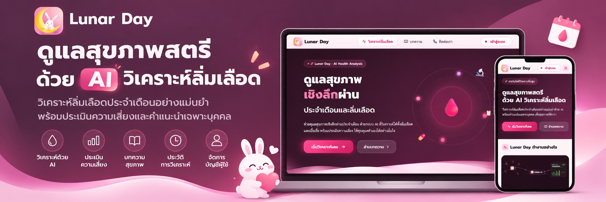
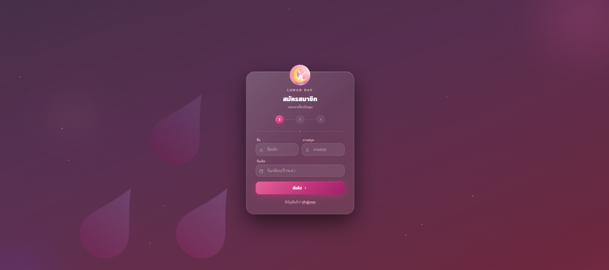
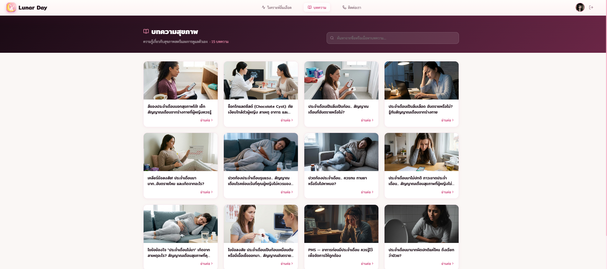
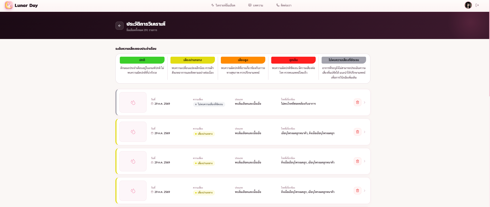
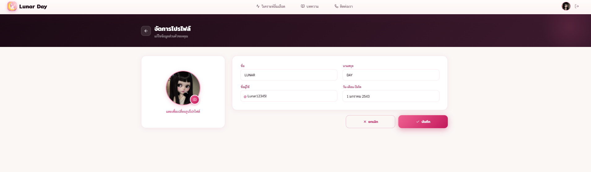

<div align="center">

# 🌙 Lunar Day

### AI-Powered Menstrual Health Analysis

เว็บแอปพลิเคชันสำหรับประเมินความเสี่ยงเบื้องต้นจากภาพลิ่มเลือดประจำเดือน
ด้วยเทคโนโลยีปัญญาประดิษฐ์และการเรียนรู้เชิงลึก



**ดูแลสุขภาพสตรีด้วย AI เพื่อความเข้าใจสุขภาพประจำเดือนที่ดียิ่งขึ้น**

</div>

---

## 📑 สารบัญ

- [เกี่ยวกับโปรเจกต์](#เกี่ยวกับโปรเจกต์)
- [เทคโนโลยีและเครื่องมือที่ใช้](#เทคโนโลยีและเครื่องมือที่ใช้)
- [โครงสร้างโปรเจกต์](#โครงสร้างโปรเจกต์)
- [ข้อกำหนดเบื้องต้น](#ข้อกำหนดเบื้องต้น)
- [การติดตั้งและใช้งานด้วย Docker](#การติดตั้งและใช้งานด้วย-docker)
- [การทดสอบระบบ](#การทดสอบระบบ)
- [ฟังก์ชันการใช้งาน](#ฟังก์ชันการใช้งาน)
- [Backend API](#backend-api)
- [การแก้ไขปัญหา](#การแก้ไขปัญหา)
- [ข้อควรระวัง](#ข้อควรระวัง)
- [Contributing](#contributing)

---


---

## เกี่ยวกับโปรเจกต์

**Lunar Day** เป็นเว็บแอปพลิเคชันที่พัฒนาขึ้นเพื่อช่วยประเมินความเสี่ยงเบื้องต้นจากลิ่มเลือดประจำเดือน โดยใช้เทคโนโลยีปัญญาประดิษฐ์ ในการวิเคราะห์ภาพร่วมกับข้อมูลอาการที่ผู้ใช้งานกรอกผ่านแบบสอบถาม ระบบจะแสดงผลการประเมินความเสี่ยง พร้อมคำแนะนำเบื้องต้น เพื่อส่งเสริมให้ผู้หญิงเข้าใจและใส่ใจสุขภาพประจำเดือนของตนเองมากยิ่งขึ้น ทั้งนี้ ข้อมูลด้านสุขภาพและแนวทางการประเมินได้รับคำปรึกษาจากแพทย์สูตินรีเวช

ระบบแบ่งผลการประเมินออกเป็น 5 ระดับ ดังนี้

| สัญลักษณ์ | ระดับความเสี่ยง |
|---|---|
| 🟢 | ปกติ |
| 🟡 | เสี่ยงปานกลาง |
| 🟠 | เสี่ยงสูง |
| 🔴 | ฉุกเฉิน |
| ⚪ | ไม่พบความเสี่ยงที่ชัดเจน |


### การพัฒนาและคัดเลือกโมเดล AI
ในการพัฒนาโมเดลสำหรับวิเคราะห์ภาพ ผู้พัฒนาได้ทดลองและเปรียบเทียบโมเดลทั้งหมด 4 สถาปัตยกรรม ได้แก่ ResNet50, EfficientNet-B0, DenseNet121 และ InceptionResNetV2 โดยทดลองใช้อัตราการเรียนรู้  จำนวน 3 รูปแบบ ได้แก่ 0.001, 0.0001 และ 0.00001 จากผลการทดลอง ได้คัดเลือก **InceptionResNetV2 ที่ใช้อัตราการเรียนรู้ 0.00001** เป็นโมเดลที่มีประสิทธิภาพเหมาะสมที่สุด และนำโมเดลดังกล่าวไปพัฒนาต่อ โดยทดลองเปรียบเทียบฟังก์ชันการสูญเสีย จำนวน 4 รูปแบบ ได้แก่

1. Weighted Cross-Entropy (WCE)
2. Dice Loss
3. WCE + Dice Loss
4. Tversky Loss

จากกระบวนการทดลองและเปรียบเทียบประสิทธิภาพของโมเดล ทั้งในด้านสถาปัตยกรรม อัตราการเรียนรู้ และฟังก์ชันการสูญเสีย ผู้พัฒนาได้คัดเลือก InceptionResNetV2 ที่ใช้อัตราการเรียนรู้ 0.00001 เป็นโมเดลสำหรับนำไปพัฒนาและใช้งานในระบบ Lunar Day โดยพิจารณาจากผลการประเมินที่ใช้ค่า Recall และ Dice Similarity Coefficient (DSC) เป็นเกณฑ์หลัก ร่วมกับ Precision, Learning Curve และ Intersection over Union (IoU)


### ✨ ฟีเจอร์หลัก
- 📝 **User Registration** — สมัครสมาชิกและสร้างบัญชีผู้ใช้งาน
- 🔬 **AI Image Analysis** — วิเคราะห์ภาพลิ่มเลือดประจำเดือนด้วยเทคโนโลยี AI และประเมินความเสี่ยง
- 📚 **Health Articles** — คลังบทความและความรู้ด้านสุขภาพผู้หญิง
- 🗂️ **Analysis History** — บันทึกและเรียกดูประวัติการวิเคราะห์
- 👤 **User Profile** — จัดการข้อมูลส่วนตัวและบัญชีผู้ใช้งาน

> **หมายเหตุ:** Lunar Day เป็นเครื่องมือสำหรับประเมินความเสี่ยงเบื้องต้น ไม่สามารถใช้แทนการวินิจฉัยจากแพทย์ได้


[กลับไปสารบัญ](#สารบัญ)

## เทคโนโลยีและเครื่องมือที่ใช้
| ส่วนประกอบ | เทคโนโลยี |
|---|---|
| Frontend | Next.js, React, TypeScript, Tailwind CSS |
| Backend | Python, Flask |
| AI / Deep Learning | PyTorch, segmentation-models-pytorch, OpenCV |
| Database | MySQL 8.4 |
| Containerization | Docker, Docker Compose |
| Image Annotation | Roboflow |
| Version Control | Git |

### ไฟล์สำคัญสำหรับการติดตั้ง

| ไฟล์ | รายละเอียด |
|---|---|
| `docker-compose.yml` | กำหนดบริการ Frontend, Backend และ MySQL |
| `frontend/Dockerfile` | กำหนดขั้นตอน Build และเริ่ม Frontend |
| `backend/Dockerfile` | กำหนดสภาพแวดล้อมและ Dependencies ของ Backend |
| `.env.docker.example` | ตัวอย่างตัวแปรสภาพแวดล้อมสำหรับ Docker |
| `database/Dump_Lunar_Docker.sql` | SQL Dump สำหรับเริ่มต้นฐานข้อมูล |
| `backend/InceptionResnet-V2-LR-0.00001.pth` | ไฟล์โมเดล AI ที่ผ่านการฝึกสอนแล้ว |

---


### ไฟล์โมเดลและไฟล์ฐานข้อมูล

| ไฟล์ | รายละเอียด |
| :--- | :--- |
| `InceptionResnet-V2-LR-0.00001.pth` | ไฟล์โมเดล AI ที่ผ่านการฝึกสอนแล้ว ให้วางไว้ในโฟลเดอร์ `backend/` |

**ลิงก์ดาวน์โหลดไฟล์**
- ดาวน์โหลดไฟล์ AI Model: [InceptionResnet-V2-LR-0.00001.pth](https://drive.google.com/file/d/1aZNYYyzp_yvnleVKbwixL3YVA3ZXlUKB/view?usp=sharing)

[กลับไปสารบัญ](#สารบัญ)

## โครงสร้างโปรเจกต์

โครงสร้างสำคัญของโปรเจกต์สำหรับการติดตั้งด้วย Docker ควรมีลักษณะดังนี้

```text
Lunar-Day/
│
├── backend/
│   ├── Dockerfile
│   ├── app.py
│   ├── requirements.txt
│   ├── incep_exp12.pth
│   ├── config/
│   ├── routes/
│   ├── static/
│   └── uploads/
│
├── frontend/
│   ├── Dockerfile
│   ├── package.json
│   ├── package-lock.json
│   ├── next.config.ts
│   ├── public/
│   └── app/
│
├── database/
│   └── Dump_Lunar_Docker.sql
│
├── .env.docker.example
├── docker-compose.yml
└── README.md
```

[กลับไปสารบัญ](#สารบัญ)

## ข้อกำหนดเบื้องต้น

เครื่องคอมพิวเตอร์ที่ใช้ติดตั้งต้องมี

1. **Docker Desktop** สำหรับ Windows หรือ Docker Engine และ Docker Compose สำหรับระบบปฏิบัติการที่รองรับ
2. การเชื่อมต่ออินเทอร์เน็ตในขั้นตอนดาวน์โหลด Image และ Build ครั้งแรก
3. RAM และพื้นที่จัดเก็บข้อมูลเพียงพอสำหรับ Docker Images, Dependencies และไฟล์ AI Model

ไม่จำเป็นต้องติดตั้ง Python, Node.js หรือ MySQL Server แยกบนเครื่อง เนื่องจากบริการเหล่านี้ทำงานภายใน Docker Containers

### ดาวน์โหลดและติดตั้ง Docker Desktop

1. เข้าเว็บไซต์ [Docker Desktop](https://www.docker.com/products/docker-desktop/)
2. ดาวน์โหลดเวอร์ชันที่ตรงกับระบบปฏิบัติการ
3. ติดตั้ง Docker Desktop ตามขั้นตอนของโปรแกรม
4. หากใช้ Windows ให้ทำตามคำแนะนำเกี่ยวกับ WSL 2 ที่ตัวติดตั้งแสดง
5. เปิด Docker Desktop และรอจนกว่า Docker Engine จะพร้อมใช้งาน

เปิด PowerShell แล้วตรวจสอบการติดตั้งด้วยคำสั่ง

```powershell
docker --version
docker compose version
```

หากแสดงหมายเลขเวอร์ชัน แสดงว่าสามารถเรียกใช้ Docker และ Docker Compose จาก PowerShell ได้

---

## การติดตั้งและใช้งานด้วย Docker

### 1. ดาวน์โหลดโปรเจกต์

เปิด PowerShell แล้วใช้คำสั่ง

```powershell
git clone https://github.com/yourmenis/Lunar-Day.git
cd Lunar-Day
```


### 2. เตรียมไฟล์ที่จำเป็น

ตรวจสอบว่ามีไฟล์ต่อไปนี้ครบถ้วน

- `database/Dump_Lunar_Docker.sql`
- `backend/incep_exp12.pth`
- `docker-compose.yml`
- `backend/Dockerfile`
- `frontend/Dockerfile`

หากไฟล์ SQL Dump หรือไฟล์ AI Model ไม่ได้อยู่ใน Repository ให้ดาวน์โหลดจากแหล่งที่ผู้พัฒนาเตรียมไว้ และวางในตำแหน่งตามโครงสร้างโปรเจกต์

### 3. ตั้งค่า Environment Variables

ระบบ Lunar Day ใช้ Gmail ในการส่งรหัส OTP สำหรับการยืนยันตัวตนและการรีเซ็ตรหัสผ่าน ผู้ติดตั้งจึงต้องเตรียมบัญชี Gmail และสร้าง App Password สำหรับเชื่อมต่อกับระบบ

ขั้นตอนที่ 1: เปิดใช้งาน 2-Step Verification
1. เข้าสู่ Google Account
2. เลือกเมนู Security
3. ไปที่หัวข้อ How you sign in to Google
4. เลือก 2-Step Verification
5. ทำตามขั้นตอนที่ Google กำหนดจนเปิดใช้งานสำเร็จ

ขั้นตอนที่ 2: สร้าง App Password
1. เข้าเว็บไซต์ Google App Passwords
2. ลงชื่อเข้าใช้บัญชี Google หากระบบร้องขอ
3. ตั้งชื่อ App Password เช่น Lunar Day
4. กดปุ่ม Create ตามหน้าจอที่แสดง
5. Google จะแสดง App Password จำนวน 16 ตัวอักษร
6. คัดลอก App Password เก็บไว้ เนื่องจาก Google จะไม่แสดงรหัสเดิมให้ดูอีกครั้ง

ขั้นตอนที่ 3: สร้างไฟล์ Environment Variables

เปิด PowerShell ที่โฟลเดอร์หลักของโปรเจกต์ แล้วคัดลอกไฟล์ตัวอย่างเพื่อสร้างไฟล์ .env.docker

```powershell
Copy-Item .env.docker.example .env.docker
```

เปิดไฟล์ `.env.docker` แล้วกำหนดค่าตามตัวอย่างต่อไปนี้

```env
MYSQL_ROOT_PASSWORD=กำหนดรหัสผ่านสำหรับ MySQL root
DB_PASSWORD=กำหนดรหัสผ่านสำหรับ lunar_user
JWT_SECRET_KEY=กำหนดค่า Secret Key ที่คาดเดายาก
GMAIL_USER1=อีเมล Gmail สำหรับส่ง OTP
GMAIL_APP_PASSWORD=Gmail App Password
```

รายละเอียดตัวแปร

| ตัวแปร | รายละเอียด |
|---|---|
| `MYSQL_ROOT_PASSWORD` | รหัสผ่านผู้ดูแลระบบ MySQL |
| `DB_PASSWORD` | รหัสผ่านของผู้ใช้ฐานข้อมูล `lunar_user` |
| `JWT_SECRET_KEY` | Secret Key สำหรับสร้างและตรวจสอบ JWT Token |
| `GMAIL_USER1` | บัญชี Gmail ที่ใช้ส่ง OTP |
| `GMAIL_APP_PASSWORD` | App Password สำหรับเชื่อมต่อ Gmail |

**ข้อควรทราบ**

- กำหนดรหัสผ่านและ Secret Key ของเครื่องที่ติดตั้งเอง ไม่ใช้ค่าตัวอย่างตามตัวอักษร
- หากต้องการทดสอบการส่ง OTP ต้องกำหนด Gmail และ App Password ที่ใช้งานได้ โดยผู้ติดตั้งควรใช้บัญชีของตนเอง
- ห้ามเผยแพร่ไฟล์ `.env.docker` หรือ Commit ไฟล์นี้ขึ้น GitHub
- ไม่ต้องส่งรหัสผ่าน Gmail หรือ Secret Key ของผู้พัฒนาให้อาจารย์

### 4. Build และเริ่มระบบ

เปิด PowerShell ในโฟลเดอร์หลัก `Lunar-Day` แล้วรันคำสั่ง

```powershell
docker compose --env-file .env.docker up -d --build
```

Docker Compose จะดำเนินการดังนี้

1. Build Frontend Image
2. Build Backend Image และติดตั้ง Dependencies ที่กำหนดไว้
3. สร้างและเริ่ม MySQL Container
4. เริ่ม Backend Container หลังจาก MySQL ผ่าน Health Check
5. เริ่ม Frontend Container

การ Build ครั้งแรกอาจใช้เวลานาน ขึ้นอยู่กับความเร็วอินเทอร์เน็ตและประสิทธิภาพของเครื่อง เนื่องจากต้องดาวน์โหลด Base Images และติดตั้ง Dependencies

### 5. ตรวจสอบสถานะ Containers

```powershell
docker compose --env-file .env.docker ps
```

ควรตรวจสอบให้บริการทั้ง 3 ส่วน ได้แก่ `mysql`, `backend` และ `frontend` อยู่ในสถานะทำงาน

หากต้องการดู Log ของทุกบริการ

```powershell
docker compose --env-file .env.docker logs --tail=100
```

หากต้องการดู Log เฉพาะบริการ

```powershell
docker compose --env-file .env.docker logs backend
docker compose --env-file .env.docker logs frontend
docker compose --env-file .env.docker logs mysql
```

### 6. เข้าใช้งานระบบ

เมื่อ Containers เริ่มทำงานแล้ว เปิดเว็บเบราว์เซอร์และเข้าใช้งานตาม URL ต่อไปนี้

| Service | URL |
|---|---|
| Frontend | http://localhost:3000 |
| Backend API | http://localhost:5000/ |

เมื่อเปิด `http://localhost:5000/` ควรได้รับข้อความแจ้งว่า API ทำงานอยู่

```json
{
  "message": "Luna Day API is running!",
  "version": "1.0.0",
  "status": "success"
}
```

---

## การตรวจสอบระบบ

หลังเริ่มระบบแล้ว ให้ตรวจสอบการทำงานของฟังก์ชันหลัก

- [ ] Docker Containers ทั้ง 3 บริการเริ่มทำงาน
- [ ] เปิดเว็บไซต์ผ่าน `http://localhost:3000` ได้
- [ ] Backend ตอบกลับที่ `http://localhost:5000/`
- [ ] Backend เชื่อมต่อฐานข้อมูล MySQL ได้
- [ ] สมัครสมาชิกและเข้าสู่ระบบได้
- [ ] ระบบส่งและยืนยัน OTP ได้ (เมื่อกำหนดค่า Gmail แล้ว)
- [ ] เปิดอ่านบทความสุขภาพได้
- [ ] อัปโหลดภาพเพื่อวิเคราะห์ได้
- [ ] ระบบเรียกใช้งาน AI Model ได้
- [ ] แสดงผลการประเมินและประวัติการวิเคราะห์ได้
- [ ] ดูและแก้ไขข้อมูลโปรไฟล์ได้

หากพบปัญหา สามารถตรวจสอบ Log ของแต่ละ Container เพื่อดูรายละเอียดข้อผิดพลาดได้

---

## การหยุดและเริ่มระบบใหม่

### หยุดระบบ

```powershell
docker compose --env-file .env.docker down
```

คำสั่งนี้จะหยุดและลบ Containers กับ Network ของ Compose แต่ **ไม่ลบ Docker Volume ที่เก็บข้อมูล MySQL** ทำให้ข้อมูลฐานข้อมูลยังคงอยู่

### เริ่มระบบอีกครั้ง

```powershell
docker compose --env-file .env.docker up -d
```

### หยุด Containers ชั่วคราว

```powershell
docker compose --env-file .env.docker stop
```

### เริ่ม Containers ที่หยุดไว้

```powershell
docker compose --env-file .env.docker start
```

> **คำเตือน:** ไม่ควรใช้ `docker compose down -v` หากต้องการเก็บข้อมูลฐานข้อมูลไว้ เพราะตัวเลือก `-v` จะลบ Volume ที่เกี่ยวข้องกับ Compose ด้วย

### หมายเหตุเกี่ยวกับการนำเข้าฐานข้อมูล

Docker Compose กำหนดให้ MySQL นำเข้าไฟล์ `database/Dump_Lunar_Docker.sql` เมื่อเริ่มต้นใช้งานครั้งแรกและ Data Directory ยังว่างอยู่เท่านั้น

หากมี MySQL Volume เดิมอยู่แล้ว การแก้ไขไฟล์ SQL Dump หรือสั่ง Build ใหม่จะไม่ทำให้ MySQL นำเข้าข้อมูลใหม่โดยอัตโนมัติ

---

[กลับไปสารบัญ](#สารบัญ)


## ฟังก์ชันการใช้งาน

### 1. สมัครสมาชิก (User Registration)

ลงทะเบียนเพื่อสร้างบัญชีผู้ใช้งาน โดยกรอกชื่อ นามสกุล วันเกิด อีเมล ชื่อผู้ใช้งาน และรหัสผ่าน พร้อมยอมรับเงื่อนไขการใช้งาน

<p align="center">
  
</p>

### 2. การเข้าสู่ระบบ (User Login)

เข้าสู่ระบบด้วยชื่อผู้ใช้งานและรหัสผ่านที่ลงทะเบียนไว้

<p align="center">
  
</p>

### 3. ลืมรหัสผ่าน (Forgot Password)

ระบุอีเมลที่ลงทะเบียนไว้ เพื่อรับรหัส OTP จำนวน 6 หลักทางอีเมล สำหรับยืนยันตัวตนและกำหนดรหัสผ่านใหม่

<p align="center">
  
</p>

### 4. วิเคราะห์ลิ่มเลือดประจำเดือน (AI Analysis)

อัปโหลดภาพลิ่มเลือดประจำเดือนเพื่อวิเคราะห์ด้วย AI พร้อมระบุข้อมูลอาการสำหรับการคัดกรอง และแสดงผลการประเมินความเสี่ยงเบื้องต้น

<p align="center">
  
</p>

### 5. บทความ (Health Articles)

อ่านและค้นหาบทความเกี่ยวกับสุขภาพสตรี เพื่อเพิ่มความรู้และความเข้าใจเกี่ยวกับสุขภาพประจำเดือน

<p align="center">
  
</p>

### 6. ประวัติการวิเคราะห์ (Analysis History)

ดูรายละเอียดผลการวิเคราะห์ย้อนหลัง และสามารถลบประวัติการวิเคราะห์ได้

<p align="center">
  
</p>

### 7. โปรไฟล์ (User Profile)

ดูและแก้ไขข้อมูลส่วนตัว รวมถึงเปลี่ยนรูปโปรไฟล์

<p align="center">
  
</p>


[กลับไปสารบัญ](#สารบัญ)

## Backend API

Base URL สำหรับ Localhost

```text
http://localhost:5000
```

Endpoint ที่ต้องเข้าสู่ระบบให้ส่ง Access Token ใน Header

```http
Authorization: Bearer <token>
```

| Method | Endpoint | รายละเอียด |
|---|---|---|
| POST | `/auth/register` | สมัครสมาชิก |
| POST | `/auth/login` | เข้าสู่ระบบ |
| POST | `/auth/forgot-password` | ขอ OTP |
| POST | `/auth/verify-otp` | ยืนยัน OTP |
| POST | `/auth/reset-password` | ตั้งรหัสผ่านใหม่ |
| POST | `/analysis/image` | อัปโหลดภาพวิเคราะห์ |
| POST | `/analysis/risk` | ส่งแบบสอบถามประเมินความเสี่ยง |
| GET | `/analysis/result/<id>` | ดูผลวิเคราะห์ |
| GET | `/history/` | ดูประวัติ |
| GET / DELETE | `/history/<id>` | ดู / ลบประวัติ |
| GET | `/profile/` | ดูโปรไฟล์ |
| POST | `/profile/update` | แก้ไขโปรไฟล์ |
| DELETE | `/profile/delete` | ลบบัญชี |
| POST | `/profile/logout` | ออกจากระบบ |
| GET | `/articles` | ดูบทความ |
| GET | `/articles/<id>` | ดูรายละเอียดบทความ |
| GET | `/articles/search?q=<คำค้น>` | ค้นหาบทความ |
| GET | `/uploads/<filename>` | เรียกดูไฟล์ภาพ |

[กลับไปสารบัญ](#สารบัญ)

## การแก้ไขปัญหา

| ปัญหา | วิธีตรวจสอบ / แนวทางแก้ไข |
|---|---|
| Docker ไม่ทำงาน | เปิด Docker Desktop และรอให้ Docker Engine พร้อมใช้งาน |
| คำสั่ง `docker` ไม่พบ | ตรวจสอบการติดตั้ง Docker Desktop และเปิด PowerShell ใหม่ |
| Build ไม่สำเร็จ | ตรวจสอบอินเทอร์เน็ต, Dockerfile และ Log ของขั้นตอน Build |
| Frontend เชื่อมต่อ Backend ไม่ได้ | ตรวจสอบ Backend URL และ Log ของ Frontend/Backend |
| Backend เชื่อมต่อ MySQL ไม่ได้ | ตรวจสอบค่า Environment Variables และสถานะ MySQL |
| MySQL ไม่เริ่มทำงาน | ตรวจสอบ Log ของ MySQL และค่า `MYSQL_ROOT_PASSWORD` |
| ไม่พบ AI Model | ตรวจสอบว่า `incep_exp12.pth` อยู่ใน `backend/` และถูกนำเข้าใน Build Context |
| ไม่ได้รับ OTP | ตรวจสอบ Gmail, App Password และโฟลเดอร์ Spam |
| พอร์ต 3000 หรือ 5000 ถูกใช้งาน | ปิดโปรแกรมที่ใช้พอร์ตดังกล่าว หรือปรับ Port Mapping ให้เหมาะสม |
| ข้อมูลฐานข้อมูลไม่เปลี่ยนตาม SQL Dump | ตรวจสอบว่า MySQL Volume มีข้อมูลเดิมอยู่หรือไม่ |
| รูปภาพไม่แสดง | ตรวจสอบ URL รูปภาพและค่า `SERVER_URL` |


[กลับไปสารบัญ](#สารบัญ)

## ข้อควรระวัง

- ห้ามเผยแพร่ไฟล์ `.env` รหัสผ่าน และ Token ต่าง ๆ
- ไม่ควรเปิด MySQL ให้เข้าถึงจากอินเทอร์เน็ตโดยตรง
- จำกัด CORS ให้เฉพาะโดเมน Frontend ที่ใช้งาน
- ไม่ควรเปิด Flask Debug Mode สำหรับการใช้งานผ่านอินเทอร์เน็ต
- ควรสำรองฐานข้อมูลและไฟล์ภาพอย่างสม่ำเสมอ
- ผลประเมินจาก Lunar Day เป็นข้อมูลเบื้องต้น ไม่ใช่การวินิจฉัยทางการแพทย์

## Contributing

หากต้องการมีส่วนร่วมในการพัฒนา Lunar Day สามารถดำเนินการได้ตามขั้นตอนต่อไปนี้

1. Fork โปรเจกต์ไปยัง GitHub Account ของตนเอง
2. สร้าง Branch สำหรับการแก้ไขหรือพัฒนาฟังก์ชันใหม่
3. แก้ไข Source Code และทดสอบการทำงานก่อนส่ง
4. Commit การเปลี่ยนแปลง พร้อมเขียนข้อความอธิบายให้เข้าใจง่าย
5. Push Branch ขึ้น GitHub
6. เปิด Pull Request เพื่อเสนอการเปลี่ยนแปลงให้ทีมพิจารณา

โปรดตรวจสอบว่าไม่มีไฟล์ `.env`, รหัสผ่าน, Token หรือข้อมูลส่วนบุคคลอยู่ใน Commit ก่อนส่ง Pull Request

หากพบข้อผิดพลาดหรือมีข้อเสนอแนะ สามารถแจ้งรายละเอียดปัญหาและขั้นตอนที่ทำให้เกิดปัญหา เพื่อช่วยให้ทีมตรวจสอบได้ง่ายขึ้น

---

---

<div align="center">

**Lunar Day**  
*Supporting women's health through AI technology.*

</div>
